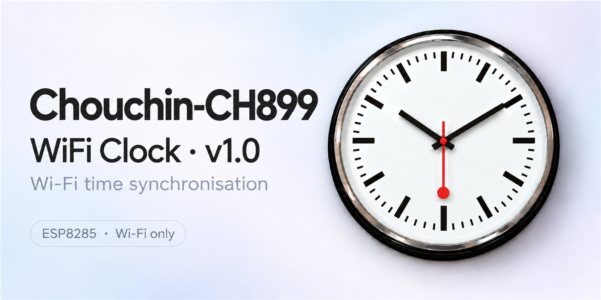

# CH899 · MM32 Wi-Fi-only upgrade · v1.0

**For the older clock board with “MM32” printed on its main chip.** Choose this project to improve Wi-Fi setup and internet timekeeping while keeping the original hand movement. Only the Wi-Fi software is replaced.

## Other clock projects

| Other repository | Choose it if… |
| --- | --- |
| [**MM32 — clock upgrade**](https://github.com/maddenste/Chouchin-CH899-MM32-ESP8285) | You have the same MM32 board and want movement styles and seconds-hand parking |
| [**HC32 — clock upgrade**](https://github.com/maddenste/Chouchin-899-latest-revision) | Your clock's main chip says HC32 |

## Check your board

Open the clock's movement cover and look for **MM32** on the large square chip, as shown below. [More board photos and identification help →](docs/REVERSE_ENGINEERING.md#hardware-identified)

Click the photo to enlarge it. If your board differs, check the identification guide before installing.

## What this upgrade adds

- **Phone-friendly Wi-Fi setup:** choose your network from a list.
- **Timezone and summer/winter time settings.**
- **Daily internet time checks:** choose 09:00, 10:00, 21:00 or 22:00.

## Install

**[Start installation →](docs/FLASHING.md)**

Follow the guide in order. It covers the equipment, download, backing up your existing Wi-Fi software and programming the clock. No compiling is required.

**Already installed?** [Change settings](docs/USER_GUIDE.md) · [Reopen the settings page](docs/USER_GUIDE.md#open-the-settings-page-again) · [Get help or report a bug](https://github.com/maddenste/Chouchin-CH899-Firmware/issues)

The clock switches Wi-Fi off after updating to save battery power. Press M.SET when you want to change settings again.

---

Unofficial project by Steve Madden · 2026. Not affiliated with the clock manufacturer.

[Downloads and release notes](https://github.com/maddenste/Chouchin-CH899-Firmware/releases/tag/v1.0.1) · [Printable manual](docs/WiFi-Clock-User-Manual-v1.0.1.pdf) · [Project journey](docs/JOURNEY.md) · [Source and building](arduino/CH899_Clock/README.md) · [GPL-3.0-or-later](LICENSE) · [Third-party notices](THIRD_PARTY_NOTICES.md)
